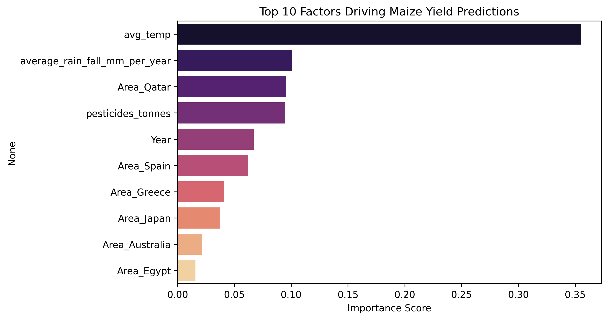

# 🌽 South African Maize Yield Prediction Using Machine Learning

## 🔗 Live Interactive Demo
👉 **[Test the Live Maize Yield Predictor App](https://streamlit.app)**

---

##
Maize is South Africa's primary staple crop, vital for national food security and rural livelihoods. However, erratic rainfall and temperature shifts make annual harvests difficult to predict. This project uses historical weather, pesticide usage, and agricultural trends to predict annual maize yield (in hg/ha), helping farmers and planners make informed decisions on storage, financing, and supply.

---

## 🗂️ Dataset & Sources
* **Primary Dataset Used:** `yield_df.csv` (1 consolidated dataset filtered for `Item == 'Maize'`)
* **Original Data Sources:** Compiled from historical agricultural yield and pesticide records from the **Food and Agriculture Organization (FAO)** merged with historical rainfall and temperature data from the **World Bank** (accessed via Kaggle's *Crop Yield Prediction Dataset*).
* **Key Features (`X`):** Country (`Area`), `Year`, Annual Rainfall (`mm/year`), Pesticide Usage (`tonnes`), and Average Temperature (`°C`).
* **Target Variable (`y`):** Maize Yield (`hg/ha_yield`).

---

## 📊 Key Results & Model Recommendation
* **Recommended Model:** Random Forest Regressor
* **R² Score (Test Set):** `0.964` (explains **96.4%** of yield variation)
* **Mean Absolute Error (MAE):** `2,351.75 hg/ha` (~`0.24 tons/hectare`)

### Engineering Journey
1. **Baseline Model (South Africa Only):** Training strictly on South African historical rows achieved an **R² of 0.37** due to limited annual records.
2. **Global Transfer & Encoding:** Expanding the dataset to include global maize records with One-Hot Encoded country features (`Area`) and `Year` trends boosted accuracy to **0.964**.

---

## 📈 Visuals & Key Insights

### 1. Actual vs. Predicted Yield (South Africa)
.png)
The predicted curve closely mirrors actual historical yields from 1990 to 2013, accurately capturing severe South African drought dips (such as 1992) as well as steady yield growth after 2000.

### 2. Top Factors Driving Maize Yield

**Average Temperature (`avg_temp`)** is the #1 driver (~35% importance), followed by **Annual Rainfall** (~10%) and **Pesticide Usage** (~10%), confirming that heat stress and water availability govern harvest outcomes.

---

## 🛠️ Tech Stack & Workflow
* **Language:** Python
* **Libraries:** Pandas, NumPy, Scikit-Learn, Matplotlib, Seaborn, Joblib, Streamlit
* **Saved Model Artifact:** `maize_yield_model.joblib`
* **Workflow:** Data Cleaning ➔ Exploratory Data Analysis ➔ One-Hot Encoding ➔ Train/Test Split ➔ Random Forest Regression ➔ Streamlit Deployment

---

## 🚀 Future Improvements
* Incorporate **monthly seasonal rainfall** rather than annual averages to capture dry spells during critical planting windows.
* Integrate local **soil moisture and nutrient data** at the South African provincial level.
*
